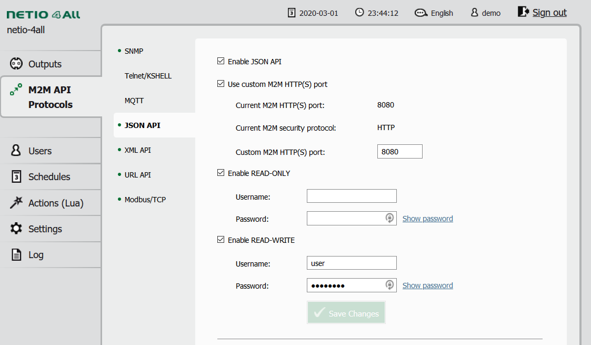

# Netio

Python bindings and a command line tool for NETIO Products power sockets.

Works with current NETIO devices running firmware 5.x (JSON API 2.6) as well as
older firmware 3.x and 4.x devices. Needs Python 3.11 or newer.

Install the latest package from pip:

```bash
pip install Netio --upgrade
```

# API Interface

Log in to your device and switch on the JSON API. You need to allow write
access if you want to switch outputs on and off.



Import Netio and create a new instance with the address of your device:

```python
from Netio import Netio

n = Netio('http://powerpdu-8qs.netio-products.com/netio.json', auth_rw=('netio', 'netio'))
```

Use `auth_rw` for a user that may read and switch outputs, or `auth_r` for a
user that may only read. Trying to switch an output with `auth_r` raises
`AuthError` before anything is sent to the device.

## HTTPS

When using HTTPS you have to either pass a certificate the device can be
checked against, or switch the check off.

 1. Under `Settings->Network Configuration` enter the correct hostname and domain.
 2. Go to `Settings->Security Settings` and select *Generate new certificate*
 3. [Download](https://docs.digicert.com/manage-certificates/client-certificates-guide/manage-your-personal-id-certificate/windows-export-your-personal-id-certificate/) the certificate from your browser

Then pass the path to the certificate as `verify`:

```python
n = Netio('https://netio.local/netio.json', auth_rw=('admin', 'password'), verify='/path/to/cert.pem')
```

If you reach the device by IP address, the certificate will not match the
address. Pass `verify=False` to switch the check off.

You can also set how long to wait for the device before giving up:

```python
n = Netio('http://netio.local/netio.json', auth_rw=('admin', 'password'), timeout=10)
```

## Control

To switch an output, pass either an action or its number:

```pydocstring
>>> n.set_output(1, 0)            # Set output 1 off
>>> n.set_output(1, n.ACTION.ON)  # Set output 1 on
```

The actions are `OFF`, `ON`, `SHORT_OFF`, `SHORT_ON`, `TOGGLE`, `NOCHANGE`
and `IGNORED`.

To switch several outputs at the same time:

```pydocstring
>>> n.set_outputs({1: n.ACTION.ON, 2: n.ACTION.OFF})
```

To read the state of the outputs:

```pydocstring
>>> for output in n.get_outputs():
>>>     print(output)
Device.OUTPUT(ID=1, Name='Dream Machine', State=1, Action=<ACTION.IGNORED: 6>, Delay=5000, Current=0, PowerFactor=1.0, Phase=0.0, Energy=43078, EnergyNR=154263, ReverseEnergy=646, ReverseEnergyNR=66452, Load=0)
Device.OUTPUT(ID=2, Name='Power output 2', State=1, Action=<ACTION.IGNORED: 6>, Delay=5000, Current=None, PowerFactor=None, Phase=None, Energy=None, EnergyNR=None, ReverseEnergy=None, ReverseEnergyNR=None, Load=None)
```

Outputs are counted from 1. `get_output(id)` returns a single output and
raises `UnknownOutputId` if there is no output with that number.

**Not every device measures power.** Devices such as the PowerCable 2PZ or the
PowerPDU 4PS report only `ID`, `Name`, `State`, `Action` and `Delay`. The other
fields are then `None`. This can also differ between outputs of one device: on
the PowerPDU 8QS above, only output 1 measures power.

# CLI Interface
```
usage: Netio [-h] [-u U] [-p P] [-C] [-c CFG] [-v] [--no-cert-warning]
             [--version]
             DEVICE COMMAND ...

positional arguments:
  DEVICE               Netio device URL
  COMMAND              device command
    get (GET, G, g)    GET output state
    set (SET, S, s)    SET output state
    info (INFO, I, i)  show device info

options:
  -h, --help           show this help message and exit
  -u, --user U         M2M API username
  -p, --password P     M2M API password
  -C, --cert           HTTPS Certificate
  -c, --config CFG     Configuration file
  -v, --verbose        increase verbosity
  --no-cert-warning    Disable warnings about certificate's subjectAltName
                       versus commonName
  --version            show program's version number and exit
```

## Commands

The Netio command line tool has 3 commands. There are some examples below.
For the full description see `Netio DEVICE CMD --help`.

### GET

Prints the current state of the outputs. All outputs are printed unless you
ask for particular ones.

```
$ NETIO_PASSWORD=netio Netio -u netio http://powerpdu-8qs.netio-products.com/netio.json GET
id      State   Action  Delay   Current PFactor Load    Energy  Name
1       1       IGNORED 5000    0       1.0     0       43078   Dream Machine
2       1       IGNORED 5000    None    None    None    None    Power output 2
```

`None` means the device does not report that value for the output.

The header is printed by default and can be switched off with `--no-header`.
The default separator is a tab and can be changed with `--delimiter ';'`
or `-d\;`.

```
$ NETIO_PASSWORD=netio Netio -u netio http://powerpdu-4ps.netio-products.com:22888/netio.json GET --delimiter ';' --no-header
1;1;IGNORED;5000;None;None;None;None;Power output 1
2;1;IGNORED;5000;None;None;None;None;Power output 2
3;1;IGNORED;5000;None;None;None;None;Power output 3
4;1;IGNORED;5000;None;None;None;None;Power output 4
```

To read a single output, add its number:

```
$ NETIO_PASSWORD=netio Netio -u netio http://powerpdu-4ps.netio-products.com:22888/netio.json GET 2
id      State   Action  Delay   Current PFactor Load    Energy  Name
2       1       IGNORED 5000    None    None    None    None    Power output 2
```

Use `--action-int` to print the action as a number instead of a name.

### SET

SET takes pairs of output number and action. At least one pair is needed.
A non zero exit code is returned when the request does not succeed.

```
$ NETIO_PASSWORD=secretPass Netio -u write http://netio.local SET 1 ON 2 OFF 3 OFF
$ echo $?
0
```

To give every output the same action, use `ALL` instead of a number.

```
$ NETIO_PASSWORD=secretPass Netio -u write http://netio.local SET ALL TOGGLE
```

**Warning**: when switching all outputs at once there is no delay between them.
With heavy loads this can cause a current spike and trip your breakers.

### INFO

Prints everything the device reports about itself. Which sections appear
depends on the model. Devices that do not measure power have no
`GlobalMeasure` section, and devices without inputs have no `Inputs` section.

```
$ Netio -u netio -p netio http://powerpdu-8qs.netio-products.com/netio.json INFO
Agent
   Model         8QS
   DeviceName    PowerPDU-EB
   MAC           24:A4:2C:39:92:EB
   SerialNumber  24A42C3992EB
   JSONVer       2.6
   Time          2026-08-12T15:15:21+0100
   Uptime        1999
   Version       5.3.1
   OemID         600
   VendorID      0
   NumOutputs    8
   NumInputs     1
GlobalMeasure
   Voltage               241.08
   TotalCurrent          0
   OverallPowerFactor    1.0
   TotalPowerFactor      1.0
   OverallPhase          0.0
   TotalPhase            0.0
   TotalEnergy           52225
   TotalReverseEnergy    756
   TotalEnergyNR         176907
   TotalReverseEnergyNR  59797
   TotalLoad             0
   EnergyStart           2021-04-15T14:08:20+0100
Inputs
   [1]
      ID            1
      Name          Input 1
      State         1
      S0Counter     1246811
      TemperatureC  999.0
      TemperatureF  999.0
      Humidity      999
```

Sections such as `Inputs`, `PAB`, `Watchdogs` and `Rules` are lists, so their
items are numbered. Reading inputs from Python is not supported yet, but they
are shown by `INFO`.

## Configuration file

You can also use a configuration file, given with `--config netio.ini` or with
the `NETIO_CONFIG` environment variable. For an explanation and an example see
[examples](examples/netio.example.ini).

## Credentials

Giving the username and password on the command line is allowed but not
advised, because anyone on the system can see them.

You can give the username and password in the configuration file or in
environment variables instead:

 - `NETIO_USER` for the username.
 - `NETIO_PASSWORD` for the password.

### Parameter lookup

A value such as the password is looked for in this order:
  1. command line argument
  2. environment variable
  3. configuration file (if given)
     1. section for that device
     2. DEFAULT section
  4. built in default (if there is one)

# Trying it out

NETIO offers public demo devices you can talk to without owning any hardware.
These 6 were working when this was last checked (2026-08-12), all on firmware
5.3.1. They accept `netio`/`netio` and also `demo`/`demo`.

| Device | URL |
|---|---|
| PowerPDU 8QS | `http://powerpdu-8qs.netio-products.com/netio.json` |
| PowerDIN 4PZ | `http://powerdin-4pz.netio-products.com:22888/netio.json` |
| PowerCable 2KZ | `http://powercable-2kz.netio-products.com:22888/netio.json` |
| PowerCable 2PZ | `http://powercable-2pz.netio-products.com/netio.json` |
| PowerPDU 4PS | `http://powerpdu-4ps.netio-products.com:22888/netio.json` |
| PowerBOX 4KX | `http://powerbox-4kx.netio-products.com/netio.json` |

Please keep in mind that these are real devices other people are also using.

# Development

```bash
poetry install
poetry run pytest          # offline tests, no network needed
poetry run pytest -m live  # tests against the demo devices listed above
```

The live tests switch output 1 of each demo device off and on again, and then
put it back the way it was.
